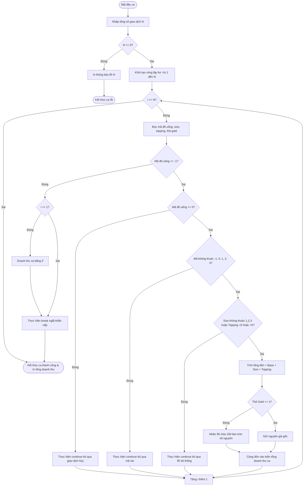

# BÁO CÁO PHÂN TÍCH TRADE-OFF VÀ TÁI CẤU TRÚC MÃ NGUỒN C QUẢN LÝ DOANH THU CA LÀM VIỆC HIGHLANDS POS

> 👤 **Học viên:** Hoàng Công Dũng | **Mã SV:** PTIT-HCM-009
> 🏫 **Môn học:** it102-rl-hoangcongdung

---

## 📊 Sơ đồ thiết kế hệ thống (Activity Diagram)

> 💡 *Sơ đồ dưới đây được render tự động trực tiếp trên GitHub bằng Mermaid. Bạn cũng có thể tải file **`bt3.drawio`** trong repository này để mở và chỉnh sửa trực tiếp trên [Draw.io (diagrams.net)](https://app.diagrams.net).* 

---

## Nhiệm vụ 1: Phân tích điểm yếu kiến trúc mã cũ và Đề xuất giải pháp

Trong các hệ thống POS thời gian thực, việc xử lý luồng giao dịch liên tục đòi hỏi mã nguồn phải vừa chính xác về nghiệp vụ, vừa có độ trễ cực thấp và khả năng chống chịu lỗi ngoại lệ từ thiết bị ngoại vi.

Mã nguồn cũ theo phong cách kiểm tra điều kiện lồng ghép nhiều tầng (Deeply Nested Logic) tạo ra nợ kỹ thuật (Technical Debt) nghiêm trọng: độ sâu mã nguồn tăng cao, khó đọc, dễ sót các trường hợp ngoại lệ như mất tín hiệu đọc thẻ hoặc khách hủy đơn đột xuất.

- Hạn chế của giải pháp 1 (Legacy Approach): Cấu trúc rẽ nhánh if-else lồng nhau làm tăng độ phức tạp không gian mã nguồn, khó duy trì và dễ gây lỗi logic khi số lượng quy tắc phụ thu và thẻ thành viên mở rộng.
- Ưu điểm của giải pháp 2 (Optimized & Refactored Approach - Guard Clauses): Sử dụng tư duy loại bỏ sớm bằng 'continue' cho các trường hợp dữ liệu rác/hủy đơn và 'break' cho tín hiệu ngắt khẩn cấp. Giúp mã nguồn phẳng hóa, trực quan và đạt hiệu năng tối ưu.

## Nhiệm vụ 2: Bảng so sánh chi tiết Trade-off giữa 2 giải pháp

Dưới đây là bảng đánh giá khách quan giữa lối tiếp cận cấu trúc lồng ghép truyền thống và phương pháp tái cấu trúc dùng Guard Clauses kết hợp điều khiển vòng lặp for:

| Tiêu chí đánh giá | Giải pháp 1: Legacy (Nested If-Else) | Giải pháp 2: Guard Clauses (Refactored For Loop) |
| --- | --- | --- |
| Số tầng lồng logic (Nesting Depth) | Lên tới 4 đến 5 tầng lồng nhau, rất khó theo dõi dòng chảy dữ liệu. | Phẳng tuyệt đối (0 tầng lồng sâu), các điều kiện kiểm tra đặt ngay đầu vòng lặp. |
| Độ phức tạp duy trì (Maintainability) | Thấp. Thêm quy tắc mới dễ làm vỡ cấu trúc và sinh lỗi logic ẩn. | Cao. Dễ dàng bổ sung hoặc chỉnh sửa từng quy tắc độc lập mà không ảnh hưởng luồng chung. |
| Tốc độ loại bỏ dữ liệu rác | Chậm và tốn tài nguyên do phải chạy qua toàn bộ khối lệnh kiểm tra dài. | Tức thì. Dữ liệu lỗi được phát hiện và loại bỏ ngay lập tức bằng lệnh 'continue'. |
| Khả năng mở rộng nghiệp vụ mới | Kém. Dễ rơi vào tình trạng 'Spaghetti Code' khi hệ thống bổ sung thêm chính sách khuyến mãi. | Tốt. Cấu trúc rõ ràng theo từng lớp bảo vệ giúp tích hợp thêm tính năng mới mẻ màng. |

## Nhiệm vụ 3: Thiết kế mã nguồn hoàn chỉnh (main.c)

Sau khi cân nhắc kỹ lưỡng các yếu tố đánh đổi, tôi quyết định chọn Giải pháp 2 làm phương án triển khai chính thức cho bài tập này. Toàn bộ mã nguồn C được viết tuân thủ nghiêm ngặt các ràng buộc: chỉ sử dụng duy nhất vòng lặp for, không dùng hàm phụ, không mảng, không struct.

- Tuân thủ tuyệt đối quy tắc làm tròn tiền tệ số nguyên bằng công thức '(tong_tien * 90) / 100' để tránh trôi số thập phân.
- Xử lý triệt để bẫy dữ liệu ngắt khẩn cấp ngay tại giao dịch đầu tiên '$i = 1$' với kết quả tổng doanh thu bằng 0 VNĐ.
- Sử dụng các câu lệnh 'continue' và 'break' chính xác theo yêu cầu kỹ thuật của đề bài.

---

## 📁 Danh sách tệp tin nộp bài trong Repository
- 📝 `bt3.docx`: Báo cáo tài liệu phân tích nghiệp vụ hoàn chỉnh.
- 🎨 `bt3.drawio`: File thiết kế sơ đồ chuẩn theo quy định đề bài (mở trực tiếp bằng [Draw.io](https://app.diagrams.net) hoặc Lucidchart).
- 💻 `main.c`: Mã nguồn chương trình.
